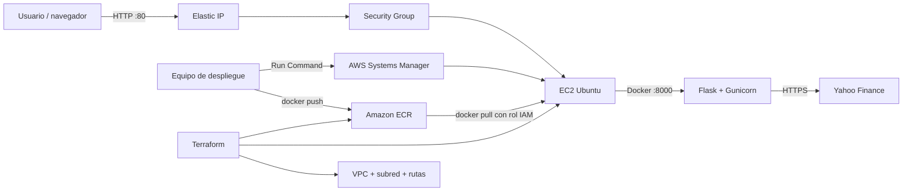

# Arquitectura de la solución

## Vista general

## Componentes

| Componente | Responsabilidad |
|---|---|
| Flask | Expone la interfaz HTML, la API JSON y `/health`. |
| Gunicorn | Ejecuta Flask con un servidor apto para producción. |
| Docker | Empaqueta código y dependencias en una imagen reproducible. |
| ECR privado | Conserva imágenes cifradas, inmutables y escaneadas. |
| EC2 Ubuntu | Ejecuta un único contenedor para el alcance académico. |
| Systems Manager | Despliega y diagnostica sin publicar el puerto SSH. |
| IAM | Da a EC2 solo lectura del repositorio y acceso administrado por SSM. |
| VPC pública | Proporciona conectividad de Internet a la demostración. |
| Elastic IP | Mantiene estable la dirección del servicio durante la vida del recurso. |

## Flujo de despliegue

1. Terraform crea red, ECR, IAM, EC2 y Elastic IP.
2. `cloud-init` instala Docker, AWS CLI y habilita SSM.
3. `deploy.ps1` construye una imagen con etiqueta inmutable y la publica en ECR.
4. El script envía un comando a EC2 mediante SSM.
5. EC2 obtiene credenciales temporales mediante su rol IAM, descarga la imagen y reemplaza el contenedor.
6. El script espera una respuesta correcta de `/health` antes de declarar éxito.

## Decisiones y límites

- La aplicación se publica por HTTP para mantener el alcance del taller. Un sistema real debe agregar DNS y HTTPS mediante un Application Load Balancer o CloudFront/ACM.
- Una sola EC2 no ofrece alta disponibilidad. Para producción se recomienda ECS Fargate o un Auto Scaling Group en varias zonas.
- El servicio depende de Yahoo Finance y su disponibilidad. No se almacenan resultados ni credenciales.
- El socket de control de Gunicorn está deshabilitado porque no se utiliza; la operación remota se realiza mediante SSM.
- La subred es pública porque EC2 necesita consultar ECR, SSM y Yahoo Finance sin el costo adicional de un NAT Gateway.
- `force_delete` permite que la práctica se destruya aunque ECR contenga imágenes. Es apropiado para el laboratorio, no necesariamente para producción.
