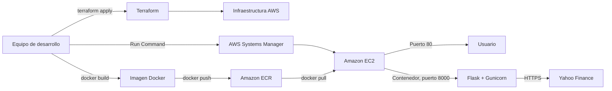

# Tecnologías utilizadas para el despliegue en AWS

## 1. Propósito del documento

Este documento describe las tecnologías que el proyecto utiliza para construir, aprovisionar, publicar y operar en AWS el servicio web de consulta de información bursátil. El análisis se basa en la implementación existente en `Dockerfile`, `infra/` y `scripts/`.

La solución sigue este flujo general:

## 2. Resumen de tecnologías

| Tecnología | Función en el despliegue | Evidencia principal |
|---|---|---|
| Terraform | Define y crea la infraestructura como código. | `infra/*.tf` |
| Proveedor AWS para Terraform | Permite administrar los recursos de AWS desde Terraform. | `infra/versions.tf` |
| Amazon VPC | Aísla lógicamente la red de la aplicación. | `aws_vpc.main` |
| Subnet, Internet Gateway y Route Table | Proporcionan conectividad pública a EC2. | `infra/main.tf` |
| Security Group | Expone únicamente HTTP en el puerto 80 y permite tráfico de salida. | `aws_security_group.web` |
| Amazon EC2 | Aloja y ejecuta el contenedor de la aplicación. | `aws_instance.app` |
| Amazon EBS | Proporciona el disco raíz cifrado de EC2. | `root_block_device` |
| Elastic IP | Entrega una dirección IPv4 pública estable. | `aws_eip.app` |
| Amazon ECR | Almacena de forma privada las imágenes Docker. | `aws_ecr_repository.app` |
| AWS IAM | Autoriza a EC2 a usar SSM y descargar imágenes desde ECR. | Recursos `aws_iam_*` |
| AWS Systems Manager | Administra y actualiza EC2 sin abrir SSH. | `deploy.ps1` y política IAM de SSM |
| cloud-init | Prepara automáticamente la instancia durante su primer arranque. | `infra/cloud-init.sh.tftpl` |
| Docker | Empaqueta y ejecuta la aplicación con sus dependencias. | `Dockerfile` y `deploy.ps1` |
| AWS CLI v2 | Autentica Docker en ECR y envía órdenes a Systems Manager. | `deploy.ps1` y `cloud-init.sh.tftpl` |
| PowerShell | Automatiza validación, despliegue, detención y destrucción. | `scripts/*.ps1` |
| Flask y Gunicorn | Exponen y sirven la aplicación Python dentro del contenedor. | `app.py`, `requirements.txt` y `Dockerfile` |

## 3. Infraestructura como código con Terraform

Terraform es la herramienta central de aprovisionamiento. En vez de crear manualmente los recursos desde la consola de AWS, el proyecto los declara en archivos versionables:

- `infra/versions.tf` fija Terraform 1.6 o posterior y el proveedor `hashicorp/aws` entre las versiones 5 y 6.
- `infra/variables.tf` permite parametrizar región, nombre del proyecto, tipo de instancia, origen autorizado para HTTP y símbolo bursátil predeterminado.
- `infra/main.tf` define la red, el repositorio, los permisos y la instancia.
- `infra/outputs.tf` publica los datos que necesitan los scripts: URL, IP pública, ID de EC2, URL de ECR y región.
- `infra/terraform.tfvars.example` sirve como plantilla de configuración.

El proveedor de AWS aplica etiquetas comunes (`Project` y `ManagedBy`) para facilitar la identificación de los recursos. El estado de Terraform conserva la relación entre la configuración y los recursos reales; por ello es necesario mantenerlo para futuras actualizaciones o para ejecutar `terraform destroy`.

## 4. Red y publicación del servicio

### Amazon VPC

El proyecto crea una VPC propia con el rango `10.42.0.0/16`. Dentro de ella existe una subred pública `10.42.1.0/24`, ubicada en la primera zona de disponibilidad disponible de la región seleccionada.

La conectividad se completa con:

- un Internet Gateway conectado a la VPC;
- una tabla de rutas con destino `0.0.0.0/0` hacia el Internet Gateway;
- la asociación entre la tabla y la subred pública;
- asignación de dirección pública a las instancias de la subred.

Esta conectividad permite que la instancia descargue paquetes, se comunique con ECR y Systems Manager, consulte Yahoo Finance y atienda solicitudes web.

### Security Group

El grupo de seguridad funciona como firewall virtual:

- permite tráfico TCP entrante únicamente por el puerto 80;
- restringe el origen mediante la variable `http_cidr`, que por defecto es `0.0.0.0/0`;
- permite todo el tráfico saliente necesario para actualizaciones, ECR, SSM y Yahoo Finance;
- no abre el puerto 22, porque la administración se realiza mediante Systems Manager.

Para una exposición menor, `http_cidr` puede configurarse con la dirección pública del operador seguida de `/32`.

### Elastic IP

La instancia recibe una Elastic IP. Esto mantiene estable la dirección pública mientras exista el recurso y permite que Terraform genere la salida `application_url` con el formato `http://<ip>`.

## 5. Cómputo con Amazon EC2

La aplicación se ejecuta en una instancia EC2 con estas características:

- Ubuntu Server 24.04 LTS oficial de Canonical;
- arquitectura `x86_64`;
- tipo `t3.micro` de forma predeterminada;
- metadatos de instancia protegidos con IMDSv2 obligatorio;
- volumen raíz EBS `gp3` de 12 GiB, cifrado y eliminado al terminar la instancia;
- perfil IAM para acceder a SSM y descargar la imagen de ECR;
- contenedor Docker publicado del puerto 8000 al puerto 80 del host.

La elección de una única EC2 simplifica el laboratorio, pero no proporciona alta disponibilidad ni escalado horizontal.

## 6. Inicialización con cloud-init

Terraform entrega a EC2 el archivo `infra/cloud-init.sh.tftpl` como datos de usuario. En el primer arranque, `cloud-init`:

1. actualiza los índices de paquetes de Ubuntu;
2. instala Docker, `curl` y `unzip`;
3. habilita el servicio Docker;
4. instala AWS CLI v2;
5. crea la configuración básica de la aplicación;
6. habilita el agente de AWS Systems Manager;
7. registra que la preparación inicial terminó.

Esta automatización hace que una instancia recién creada quede lista para recibir el despliegue sin configuración manual ni conexión SSH.

## 7. Contenedores con Docker

El `Dockerfile` construye la unidad desplegable. Utiliza `python:3.13.9-slim-bookworm`, instala las dependencias declaradas en `requirements.txt` y copia únicamente los archivos necesarios para ejecutar el servicio.

Las decisiones principales del contenedor son:

- ejecución con un usuario sin privilegios;
- puerto interno 8000;
- comprobación periódica de salud mediante `/health`;
- Gunicorn como servidor de aplicación;
- dos procesos trabajadores y dos hilos por trabajador;
- sistema de archivos sin necesidad de permisos de escritura para la aplicación.

El script construye explícitamente para `linux/amd64`, arquitectura compatible con la instancia EC2 seleccionada. `compose.yaml` se usa para reproducir localmente el contenedor, pero Docker Compose no participa en el despliegue de AWS.

## 8. Registro de imágenes con Amazon ECR

Amazon Elastic Container Registry almacena la imagen antes de que EC2 la descargue. El repositorio configurado por Terraform incluye:

- acceso privado;
- etiquetas inmutables para impedir sobrescribir una versión existente;
- análisis de vulnerabilidades al publicar cada imagen;
- cifrado AES-256 administrado por AWS;
- política de ciclo de vida que conserva las diez imágenes más recientes.

Durante el despliegue, AWS CLI obtiene un token temporal de ECR. Docker usa ese token para publicar la imagen desde el equipo local. En EC2 se genera otro token temporal para descargarla. No se guardan credenciales permanentes de AWS dentro de la imagen.

El repositorio tiene `force_delete = true`, de modo que Terraform puede eliminarlo aunque contenga imágenes. Esta decisión facilita la limpieza del laboratorio, pero debe revisarse en un entorno productivo.

## 9. Identidad y acceso con AWS IAM

Terraform crea un rol IAM y lo asocia a EC2 mediante un perfil de instancia. El rol aplica el principio de privilegio mínimo en dos áreas:

- la política administrada `AmazonSSMManagedInstanceCore` permite que la instancia sea administrada por Systems Manager;
- una política específica permite obtener un token de ECR y leer capas únicamente del repositorio de la aplicación.

Gracias al rol, el software dentro de EC2 recibe credenciales temporales automáticamente. No es necesario copiar claves de acceso al servidor ni incorporarlas al código o al contenedor.

La identidad que ejecuta Terraform y `deploy.ps1` es distinta del rol de EC2. Esa identidad local debe contar con permisos para crear la infraestructura, publicar en ECR y enviar y consultar comandos de Systems Manager.

## 10. Administración sin SSH con AWS Systems Manager

AWS Systems Manager reemplaza la administración tradicional por SSH. El proyecto usa principalmente Run Command con el documento `AWS-RunShellScript`.

`scripts/deploy.ps1` espera hasta que la instancia aparezca como `Online` en SSM y después envía instrucciones para:

1. autenticarse en ECR;
2. descargar la imagen indicada;
3. eliminar el contenedor anterior, si existe;
4. iniciar el nuevo contenedor con reinicio automático;
5. comprobar repetidamente el endpoint `/health`;
6. devolver los registros si la comprobación falla.

El script espera la terminación de Run Command y solo anuncia éxito cuando AWS devuelve el estado `Success`. Systems Manager también permite abrir una sesión de diagnóstico con Session Manager sin publicar el puerto SSH ni administrar llaves privadas.

## 11. Automatización con PowerShell y AWS CLI

Los scripts de PowerShell integran las herramientas del flujo:

- `scripts/validate.ps1`: ejecuta pruebas, valida Terraform y construye la imagen local.
- `scripts/deploy.ps1`: lee las salidas de Terraform, construye la imagen, la publica en ECR y actualiza EC2 por SSM.
- `scripts/stop.ps1`: detiene EC2 y confirma el estado final sin eliminar los demás recursos.
- `scripts/destroy.ps1`: ejecuta la destrucción controlada de la infraestructura con Terraform.

AWS CLI actúa como interfaz de automatización para ECR, EC2 y Systems Manager. En el equipo de desarrollo usa las credenciales configuradas para el operador; dentro de EC2 utiliza las credenciales temporales del rol IAM.

## 12. Tecnologías de la aplicación desplegada

Aunque no aprovisionan infraestructura, estas tecnologías forman parte del artefacto desplegado:

- **Python 3.13:** lenguaje de ejecución.
- **Flask:** ofrece la interfaz HTML, la API JSON y el endpoint `/health`.
- **Gunicorn:** sirve la aplicación Flask en un proceso adecuado para despliegue.
- **yfinance y pandas:** consultan y procesan los datos bursátiles obtenidos de Yahoo Finance.
- **Yahoo Finance:** dependencia externa consumida por HTTPS desde el contenedor.

El endpoint `/health` es importante para Docker y para el script de despliegue, pues permite comprobar que la nueva versión responde antes de considerar terminada la actualización.

## 13. Flujo completo de despliegue

1. El operador configura las variables de Terraform y sus credenciales de AWS.
2. `terraform init`, `plan` y `apply` crean la VPC, la red pública, ECR, IAM, EC2, EBS y la Elastic IP.
3. Al arrancar EC2, `cloud-init` instala Docker, AWS CLI y habilita el agente SSM.
4. `deploy.ps1` obtiene de Terraform la región, el repositorio y el ID de instancia.
5. Docker construye una imagen `linux/amd64` con una etiqueta única.
6. AWS CLI genera un token temporal y Docker publica la imagen en ECR.
7. PowerShell envía a EC2 un comando mediante Systems Manager.
8. EC2 usa su rol IAM para autenticarse, descarga la imagen e inicia el contenedor.
9. Docker enlaza el puerto público 80 de EC2 con el puerto 8000 del contenedor.
10. El script consulta `/health`; si responde correctamente, informa la URL pública.

## 14. Seguridad incorporada

La implementación incluye varias medidas adecuadas para el alcance académico:

- no expone SSH;
- usa credenciales temporales mediante IAM;
- obliga a utilizar IMDSv2 en EC2;
- cifra el volumen EBS y las imágenes en ECR;
- analiza las imágenes al publicarlas;
- ejecuta la aplicación con un usuario sin privilegios;
- usa etiquetas de imagen inmutables;
- limita la política de lectura de imágenes al repositorio del proyecto;
- elimina el token local de ECR al finalizar la publicación.

Sin embargo, la aplicación se ofrece por HTTP. Para producción debería agregarse HTTPS mediante ACM y un Application Load Balancer o CloudFront, además de DNS, observabilidad centralizada y una estrategia de copias de seguridad y recuperación.

## 15. Alcance y limitaciones de la arquitectura

La arquitectura está orientada a una práctica académica y prioriza simplicidad y costos controlables. Sus principales limitaciones son:

- una sola instancia representa un punto único de fallo;
- no existe balanceador de carga ni Auto Scaling;
- el despliegue reemplaza el contenedor en el mismo host y puede producir una interrupción breve;
- no se configuró TLS/HTTPS;
- la instancia está en una subred pública;
- no hay métricas, alarmas ni centralización de logs en CloudWatch;
- el estado de Terraform se almacena localmente y no cuenta con bloqueo remoto;
- detener EC2 no elimina todos los costos: EBS, ECR y Elastic IP permanecen activos.

Para un escenario productivo se podría migrar la ejecución a ECS Fargate o a un Auto Scaling Group distribuido en varias zonas, incorporar un Application Load Balancer con HTTPS, almacenar el estado de Terraform en un backend remoto protegido y agregar monitoreo con CloudWatch.

## 16. Archivos clave para consultar

| Archivo | Contenido |
|---|---|
| `infra/versions.tf` | Versiones de Terraform y del proveedor AWS. |
| `infra/main.tf` | Declaración completa de recursos AWS. |
| `infra/variables.tf` | Parámetros configurables. |
| `infra/outputs.tf` | Datos consumidos por los scripts. |
| `infra/cloud-init.sh.tftpl` | Preparación automática de EC2. |
| `Dockerfile` | Construcción y ejecución del contenedor. |
| `compose.yaml` | Ejecución local, no usada en AWS. |
| `scripts/deploy.ps1` | Publicación en ECR y despliegue mediante SSM. |
| `scripts/validate.ps1` | Validaciones previas al despliegue. |
| `scripts/stop.ps1` | Detención controlada de EC2. |
| `scripts/destroy.ps1` | Eliminación de la infraestructura. |

